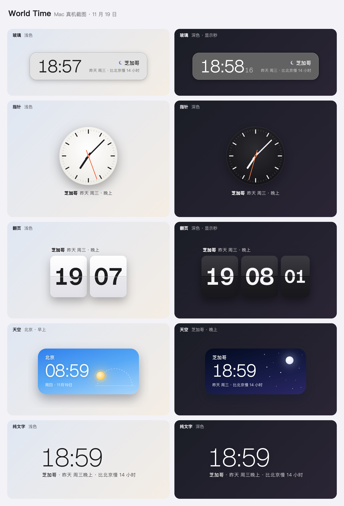

# World Time

悬浮在桌面上的时钟，Windows 和 macOS 都能用。只显示一个城市，有 5 套样式：玻璃、指针、翻页、天空、纯文字。深色、浅色默认跟随系统。

## 下载

到 [Releases](https://github.com/lanqingren/world-time/releases) 下载最新版：

- Windows：`World.Time_<版本>_x64-setup.exe`，双击安装。
- macOS（Apple 芯片和 Intel 都能用）：`World.Time_<版本>_universal.dmg`，打开后把 World Time 拖进“应用程序”。没有 Apple 开发者签名，第一次打开如果提示无法验证开发者，到“系统设置 → 隐私与安全性”最下面点“仍要打开”。

0.1.4 起会自动更新：启动后和之后每 6 小时去 Releases 看一次，有新版本就自己下载装好、重新打开，不用点。0.1.3 及更早的版本没有这个功能，要手动装一次新版。

## 用法

- 时钟默认只显示时间。右键菜单里勾上“显示城市和日期”，会把城市、星期和时差也显示出来。
- 右键时钟：换城市、样式、外观、大小、显示城市和日期、显示秒、12 小时制、鼠标穿透、开机自动启动、检查更新、隐藏、退出。菜单栏（Windows 是任务栏右下角）的图标里也有同一个菜单。
- 按住时钟拖动，位置会记住。
- 开了鼠标穿透或者把时钟隐藏了，再打开一次程序就能恢复。

## 打包

- 发版：改好 `package.json`、`src-tauri/tauri.conf.json`、`src-tauri/Cargo.toml` 里的版本号，推一个同样的 `v*` 标签（例如 `v0.1.4`），GitHub Actions 会打好 Windows 和 Mac 的安装包，连同自动更新用的 `latest.json` 一起发到 Releases。
- 更新文件要用签名钥匙签名，装好的时钟只接受这把钥匙签过的更新。公钥写在 `tauri.conf.json` 里，私钥在仓库的 Actions secret `TAURI_SIGNING_PRIVATE_KEY` 里，另存了一份在打包的 Mac 上：`~/.tauri/world-time.key`。私钥丢了，已经装好的时钟就再也收不到更新，要保管好。
- 本地打 Mac 版：`pnpm install`，然后 `TAURI_SIGNING_PRIVATE_KEY="$(cat ~/.tauri/world-time.key)" TAURI_SIGNING_PRIVATE_KEY_PASSWORD="" pnpm tauri build --bundles app`。

数字字体用的是 [Geist](https://github.com/vercel/geist-font)（SIL Open Font License 1.1，见 `src/assets/fonts/OFL.txt`）。城市的中英文名来自 [Unicode CLDR](https://cldr.unicode.org/)（Unicode License v3），坐标来自 [IANA 时区数据库](https://www.iana.org/time-zones)，由 `scripts/build_cities.py` 生成。
